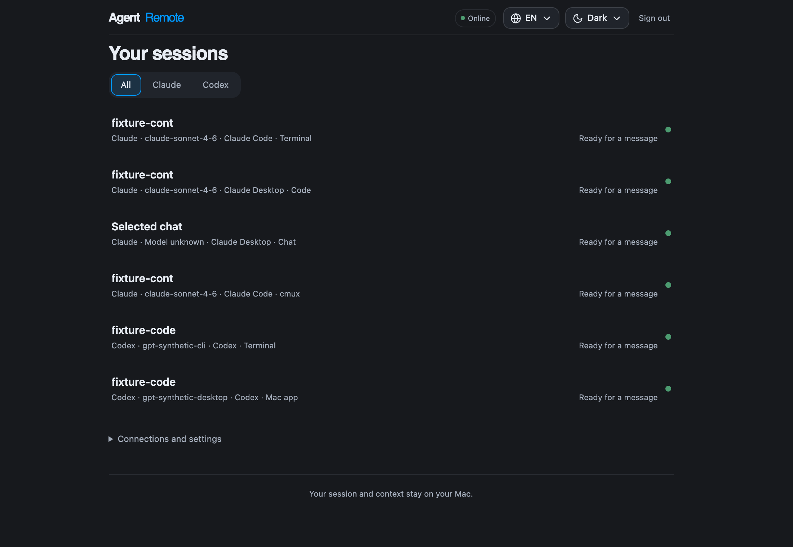
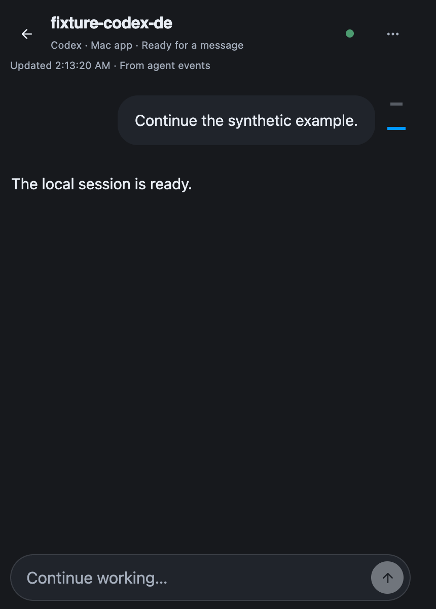

# Agent Remote

A Telegram Mini App for following and controlling Claude and Codex sessions on your Mac. The companion connects outward to a NestJS relay; your Mac runs the agent processes. The relay uses PostgreSQL, Redis and BullMQ, and the Mini App uses React, Zustand and TanStack Query.

Session capabilities depend on the connector: managed Claude Code and Codex CLI, the native Codex Mac app, optional cmux, and experimental Claude Desktop Accessibility integration. An observed session does not automatically have remote input. See the [connector boundaries](docs/codex.md) and [acceptance notes](docs/acceptance.md).

## Preview

These screenshots come exclusively from English Storybook stories with synthetic sessions and messages. They contain no real conversations. [Fixtures and capture instructions](docs/screenshots/README.md).





The Mini App includes provider filters, session creation and renaming, bounded history, saved reading positions, message navigation, questions and approvals, subagent activity, editable queued prompts, file attachments, an image viewer and available native file-edit patches. Connector capabilities determine which controls are available. The unsent prompt queue is currently in memory and is lost when the app closes or reloads.

## Agent quick start: isolated development

Read [AGENTS.md](AGENTS.md) before changing code and [frontend rules](apps/mini-app/AGENTS.md) before working on the Mini App. Create commits only when the user explicitly requests them; never bypass hooks or push without authorization. Use synthetic fixtures; do not read production credentials or start personal mode for routine development.

Requirements: Node.js **22.12+**, pnpm **10.34.7**, Git and [Gitleaks](https://github.com/gitleaks/gitleaks). Docker is needed for database-backed tests. macOS 13+ and Swift are needed for the optional native helper. Install Gitleaks on macOS with `brew install gitleaks`; CI pins version 8.30.1.

From the repository root:

```sh
pnpm install --frozen-lockfile
pnpm security:install-hooks
pnpm security:check
pnpm storybook
```

Open [Storybook](http://localhost:6006), choose the English language global, and develop against its mocked API. Storybook requires no bot token, Telegram login, live relay or agent subscription. If the port is occupied, use an isolated port as shown in the [screenshot instructions](docs/screenshots/README.md); do not stop an existing service.

If pnpm is unavailable, use the pinned package without changing global package-manager settings:

```sh
npm exec --yes --package=pnpm@10.34.7 -- pnpm install --frozen-lockfile
npm run storybook
```

The source layout is `apps/mini-app` (UI), `apps/server` (relay), `apps/daemon` (Mac companion), `apps/macos-helper` (Swift helper), and `packages/protocol` (shared wire contracts and domain values). Keep owned states and errors in named constant objects/types; keep logical blocks and component props in separate modules as required by the repository rules.

## Verification

Run strict validation without creating a commit:

```sh
docker compose -f compose.test.yml up -d --wait
pnpm validate
```

This runs secret checks, hook regression tests, TypeScript, the guarded production build (ESLint, FSD, structure, React checks, formatting and unused-code checks), and the unit/integration suite. On macOS it first builds and locally signs the native helper needed by process-context tests; other platforms skip macOS-only native tests. Browser acceptance runs separately:

```sh
docker compose -f compose.test.yml up -d --wait
pnpm security:check
pnpm security:test
pnpm test
pnpm typecheck
pnpm build
pnpm test-storybook
E2E_APP_PORT=4175 pnpm test:e2e
```

The test stack binds PostgreSQL to loopback port **55432** and Redis to **56380**, with disposable test data. Tests use these defaults; overrides are `TEST_DATABASE_URL` and `TEST_REDIS_URL`. Browser tests own relay port **3000** and the selected `E2E_APP_PORT`; run one browser suite at a time and select free ports without stopping unrelated services. Never point tests at a personal or production database.

`pnpm build` runs the source quality gates before building. `E2E_APP_PORT=4175 pnpm check:frontend` runs typechecking, the guarded build, Storybook browser tests and mobile E2E together. Storybook `play` functions contain interactions only; assertions belong in test/spec files.

For native helper or distribution changes on macOS:

```sh
swift test --package-path apps/macos-helper
pnpm build:helper
pnpm package:daemon
pnpm verify:archive
```

Archives and checksums are written to ignored `artifacts/`. Native dependencies are tied to the OS, CPU architecture and Node ABI. Public macOS distribution requires Developer ID signing and notarization; local helper signing is ad hoc.

## Run with your own Telegram bot

This starts a real service and connects your own accounts; it is separate from fixture-based development. Keep the Mac awake and online. You need Docker Desktop, `cloudflared`, and the Claude/Codex authentication required by your chosen connector.

```sh
pnpm build
brew install cloudflared
pnpm personal
```

The first launch creates a private local `.env`; enter your own `BOT_TOKEN` there, then repeat `pnpm personal`. Do not paste the token into a chat, issue or README. The launcher starts the local database, Redis, relay and tunnel, updates the bot menu, and asks you to confirm pairing on the Mac. A temporary tunnel URL can change on restart; a [named tunnel and your own domain](docs/permanent-domain.md) provide a stable origin. Configure the [Telegram Main App](docs/telegram-main-app.md) separately in BotFather.

For a separately hosted relay, copy `.env.example` to `.env`, configure `BOT_TOKEN`, `DATABASE_URL`, `REDIS_URL` and `PUBLIC_ORIGIN`, then follow [operations](docs/operations.md) and [companion installation](docs/install-daemon.md). Remote input and permission handling are explicitly gated by `REMOTE_INPUT_ENABLED` and `REMOTE_PERMISSIONS_ENABLED` on both sides. Ordinary hooked Claude sessions can remain observation-only; use the supported managed launcher to enable input. cmux is optional.

## Repository safety

`pnpm security:install-hooks` enables the checked-in hooks for this clone. The pre-commit hook scans the actual staged content, including force-added files, then validates an isolated copy of the entire Git index using `pnpm validate:commit`; unstaged edits cannot hide a staged error. Missing dependencies or failed checks block the commit. The snapshot preserves executable modes and is removed afterward; the pre-push hook checks public working files and all reachable Git history. Missing Gitleaks or a failed scan blocks the operation. `pnpm security:check` also includes untracked, nonignored candidates, so it works before the first commit. GitHub CI repeats the checks with full history.

Environment files, local device state, transcripts, logs, recordings, credentials, certificates, databases, build output and release archives are excluded and rejected by path policy if staged. `.env.example` is the only allowed environment template. Keep published images limited to reviewed synthetic fixtures such as `docs/screenshots/`; scanners cannot determine whether a screenshot shows a private conversation.

Secret detection is a safeguard, not a guarantee. Review every proposed change for private content; hooks can be bypassed, and CI only runs after upload. Before publishing to GitHub, enable host-side secret scanning/push protection and require the repository safety check in branch protection. See [the security policy](SECURITY.md). The relay can read messages transmitted through it; end-to-end encryption is not implemented.

## Documentation

- [Companion and connector installation](docs/install-daemon.md), [Codex integration](docs/codex.md), [personal launch](docs/personal-launch.md).
- [Frontend architecture](docs/frontend-architecture.md), [Storybook coverage](docs/storybook-coverage.md), [browser test coverage](docs/e2e-coverage.md).
- [Attachments and storage limits](docs/attachments.md), [Redis/BullMQ recovery](docs/redis-bullmq.md), [operations and rollback](docs/operations.md).
- [Service specification](docs/superpowers/specs/2026-10-16-telegram-cmux-design.md), [implementation status](docs/superpowers/plans/2026-10-16-claude-remote-implementation.md), [local TypeScript APIs](docs/typescript-modules.md).
- [Third-party notices](THIRD_PARTY_NOTICES.md). Some historical design and operations documents are in Russian; this README and screenshot fixtures are in English.
